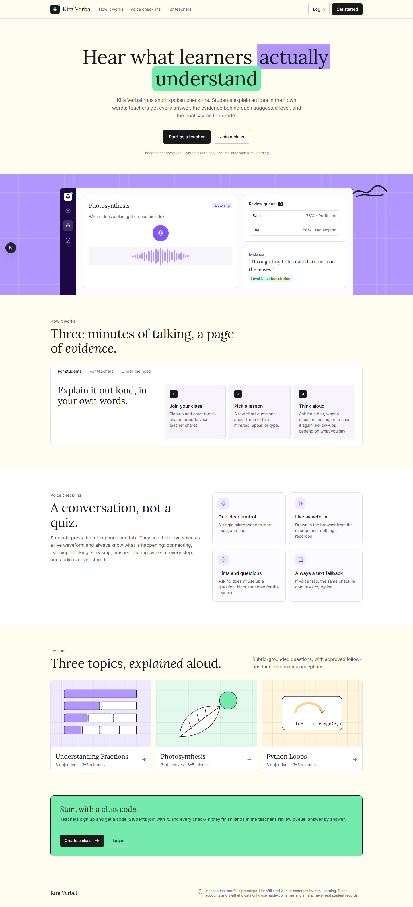
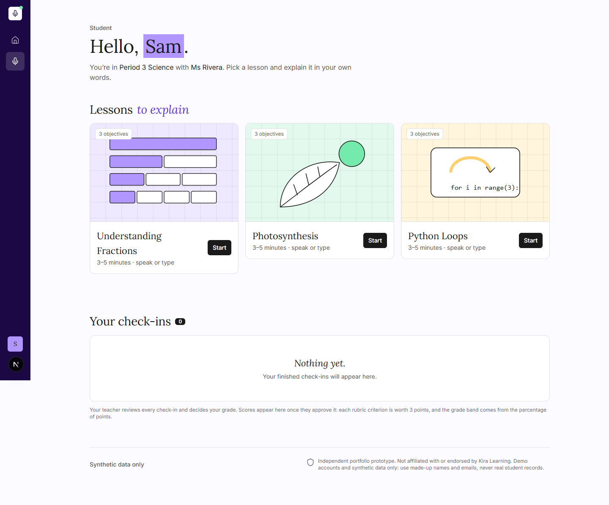
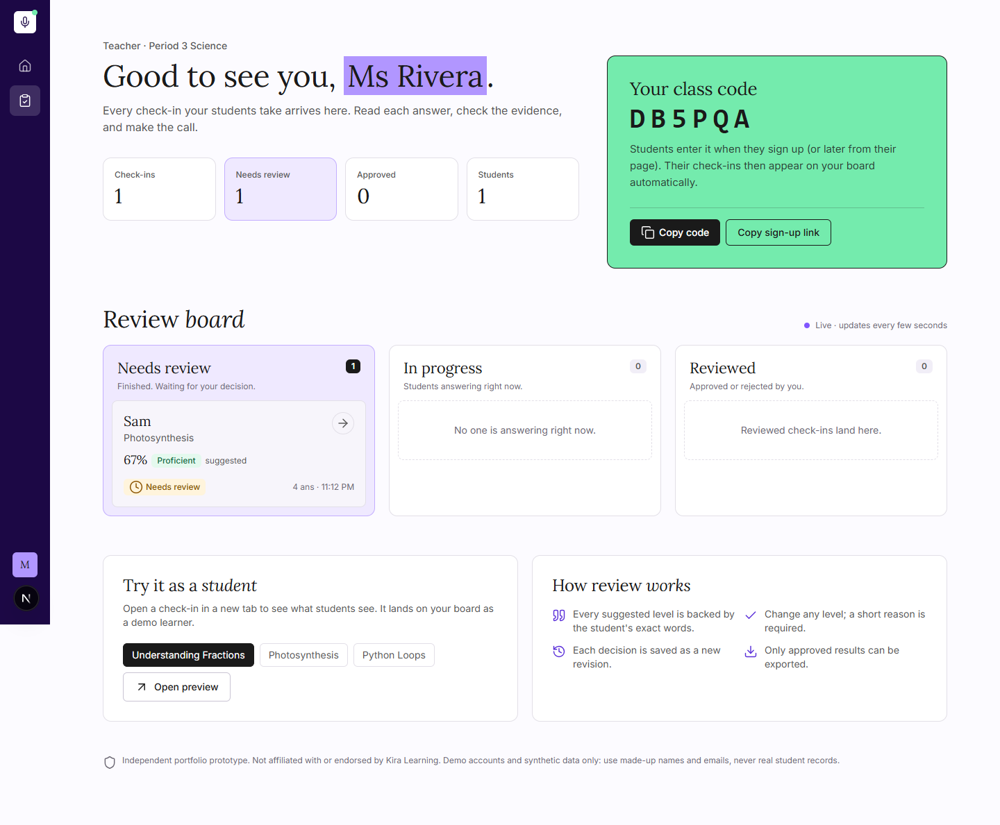
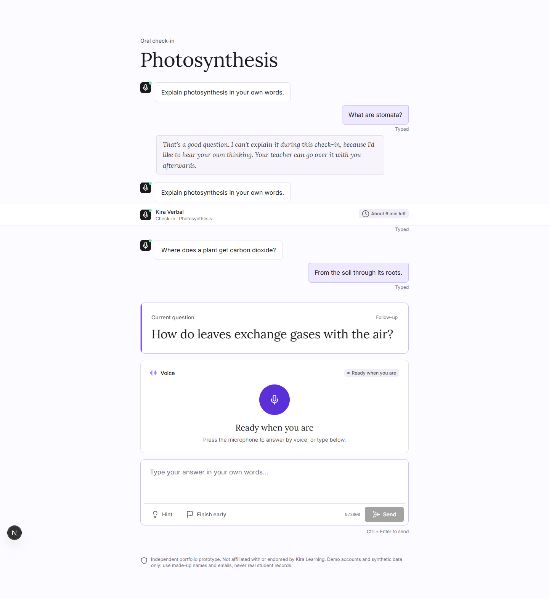
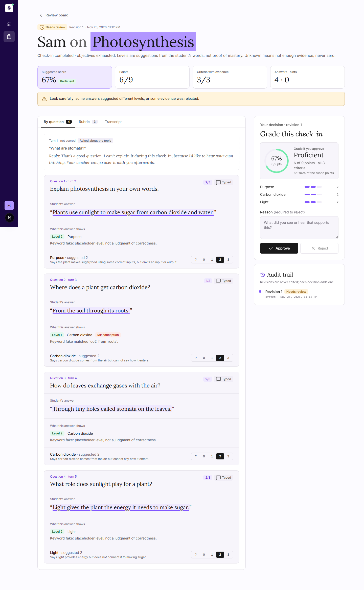
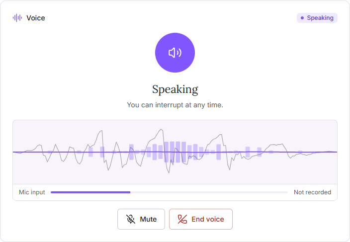
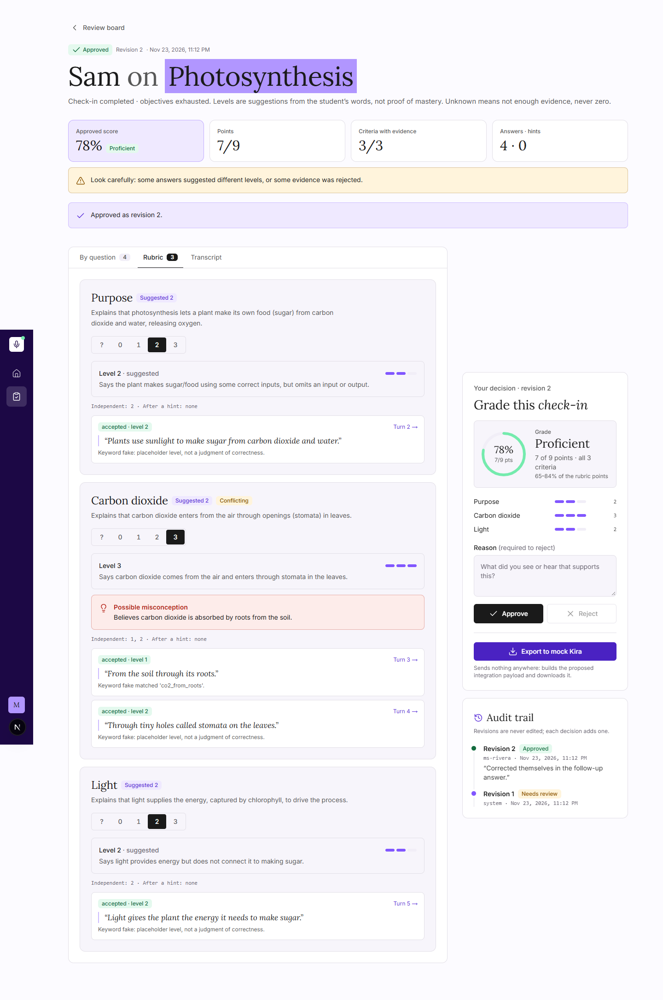
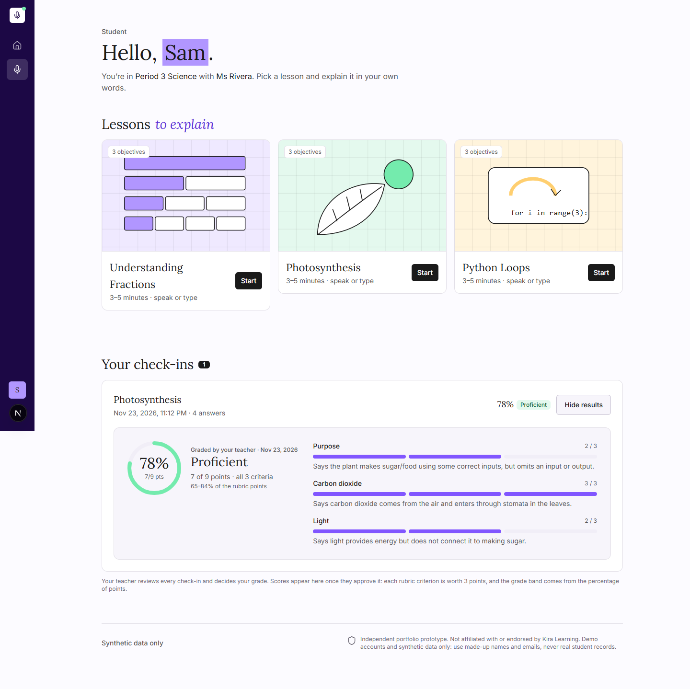
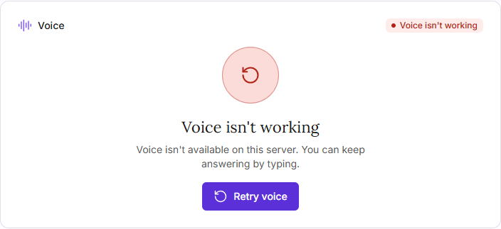
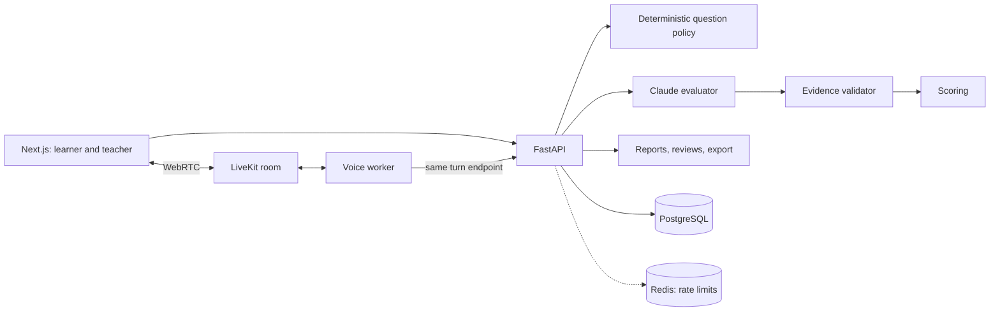

# Kira Verbal

> **Independent portfolio prototype.** It proposes an oral-assessment activity in the style of
> modern K-12 learning tools. Not affiliated with or endorsed by Kira Learning; no private API
> access or integration. Synthetic learners and adult testers only.

A short, adaptive oral check-in. A learner answers a few rubric-grounded questions by typing
or speaking. The app follows up on likely misconceptions, and gives the teacher the learner's
exact words as evidence for each suggested rubric level. The teacher approves, revises or
rejects. Nothing is graded automatically.

The hypothesis (not a validated result) is that this surfaces actionable misconceptions with
less teacher effort than running oral assessments by hand.



| Student | Teacher |
|---|---|
|  |  |
|  |  |
|  |  |
|  |  |

## What it does

1. **A teacher signs up** and gets a class with a six-character code. **Students sign up**
   with the code (demo accounts: use made-up names and emails).
2. **A student picks a lesson and answers** by typing or by voice, with a live waveform of
   their microphone while they speak. The check-in appears on the teacher's review board
   straight away. A wrong idea such as "plants get carbon
   dioxide through their roots" triggers an approved follow-up question. The learner can ask
   for a hint, ask to hear a question again, or ask about the topic; those turns are answered
   but never scored.
3. **Claude proposes evidence** for each answer: a rubric level, an exact quote, and a
   misconception tag. Code checks every item against the transcript before it counts.
   "Unknown" stays unknown; it is never turned into a zero.
4. **The teacher reviews** each answer, question by question, with the quotes and suggested
   levels it produced; changes any level (with a reason); and approves or rejects. Every
   decision is kept as a new revision.
5. **Scores.** Each rubric criterion is worth 0–3 points. The score is the points as a
   percentage, with a grade band: Beginning (under 40%), Developing (40–64%), Proficient
   (65–84%) or Mastered (85%+). A criterion with no evidence isn't counted as zero; the grade
   says "Incomplete" until the teacher sets it. The teacher sees the grade change as they
   pick levels; the student sees their grade and what each level means **only after the
   teacher approves**. These thresholds are a prototype choice, not a validated standard.
6. **Only an approved revision can be exported**, once, to a mock "Kira" adapter as JSON.

## Results so far (synthetic data only)

From [docs/evaluation.md](docs/evaluation.md), run on 2026-11-23 with Claude Haiku 5.5:

- **60 scripted learners, 120 sessions:** answer level within one of the label for 98%
  (222/227), exact for 91%. All 70 scripted misconceptions detected with no false alarms, and
  93% followed up with a second, targeted answer. The fixed-question baseline detects the same
  misconceptions but can never follow up. Cost of the run: about $0.05.
- **Automated tests:** 603 backend tests, 13 frontend unit tests and 3 browser tests pass.
- **Voice:** works end to end in manual sessions. Replies took 3.4–6.5 s, which **misses** the
  1.5 s stretch target; see [docs/voice-pipeline.md](docs/voice-pipeline.md).

These numbers describe scripted input written by the project author. They say nothing about
real learners. The honest list of what is unverified is in the evaluation doc.

## Quick start

Prerequisites: Docker Desktop. For development also Python 3.11+ and Node.js 20.15+.

### Just run it (containers, free fake mode, no keys)

```powershell
docker compose -f compose.full.yaml up --build
```

Open http://localhost:3000 → **I'm a teacher** → sign up → copy the class code. In a
private window: **I'm a student** → sign up with the code → start a lesson and answer. Back
in the teacher window the check-in is on the review board: open it, review, approve, export.

### Develop

```powershell
# 1. Dependencies (from the repo root)
docker compose up -d
Copy-Item .env.example .env          # bash: cp .env.example .env

# 2. Backend
cd backend
python -m venv .venv
.venv\Scripts\Activate.ps1            # bash: source .venv/bin/activate
pip install -e ".[dev,voice]"
alembic upgrade head
python -m app.seed                    # publishes the 3 synthetic lessons; safe to rerun
uvicorn app.main:app --port 8000

# 3. Frontend (second terminal)
cd frontend
npm install
npm run dev                           # http://localhost:3000
```

By default the evaluator is a free keyword stand-in, good for trying the flow but not for
judging answers. To use Claude, set in `.env`:

```
EVALUATOR_PROVIDER=llm
LLM_API_KEY=sk-ant-...
LLM_MODEL=claude-haiku-5-5
LLM_EFFORT=low
```

Each answer is then one paid API call (a fraction of a cent on Haiku). Voice is optional and
needs a LiveKit Cloud project: see [docs/voice-pipeline.md](docs/voice-pipeline.md).

## Tests

```powershell
cd backend
pytest -q                                  # needs Postgres and Redis from compose
ruff check . ; ruff format --check .

cd ../frontend
npm run lint ; npx tsc --noEmit ; npm test ; npm run build   # npm test = Vitest unit tests
$env:KV_PYTHON=".venv\Scripts\python"; $env:PW_CHANNEL="msedge"; npm run test:e2e   # browser test

cd ../backend
python ..\scripts\run_benchmark.py --provider fake      # free benchmark
```

Tests never read your `.env`, never make paid calls, and use their own `kira_test` database.

## Frontend

Next.js 15 (App Router), React 19, TypeScript, Tailwind 4, Lucide icons, Lora + Inter.
The visual language and every component are documented in
[frontend/DESIGN_SYSTEM.md](frontend/DESIGN_SYSTEM.md).

```
frontend/
  app/            routes: / · /login · /register · /student · /student/[id] · /teacher · /teacher/[id]
                  globals.css holds the design tokens (@theme), layout.tsx the fonts
  components/
    ui.tsx        primitives: Button, Card, Pill, Callout, Field, Stat, Icon (Lucide) …
    shell.tsx     MarketingShell (top bar) · AppShell (purple sidebar / mobile drawer) · FocusShell
    VoicePanel.tsx, Waveform.tsx   voice check-in (LiveKit) and the live waveform
    StudentHome, StudentSession, TeacherDashboard, ReportReview, AuthForm, Landing, Score …
  lib/
    api.ts        the only place that calls the API (typed, ApiError with a code)
    auth.tsx      signed-in user, role redirects
    voice-state.ts  real voice events -> UI state (unit-tested)
    grading.ts    score rule mirrored from the backend (unit-tested)
  e2e/            Playwright: sign-up → check-in → review → grade → export, voice error state
```

Rules for changes:
- Pages compose components; components don't fetch except through `lib/api.ts`; pure rules
  live in `lib/` with Vitest tests next to them.
- Use the tokens and primitives; don't add raw hex colours or new radii in components.
- Purple `#8156FF` is for icons and fills only; text in purple uses `purple-ink`
  (contrast table in the design system).
- After a visual change, run the browser tests and look at the screenshots at desktop and
  390 px wide.

## How it is built



- **The model proposes; code decides.** Claude reads an answer and proposes evidence. Fixed
  code validates it, picks the next question, computes suggested levels and ends the session.
- **One path for text and voice.** The voice worker only moves audio; it posts the final
  transcript to the same endpoint as the text form.
- **Safe to retry.** Every answer has an id; duplicates, double clicks, crashes and
  simultaneous tabs can't save a turn twice.
- **Teachers own the result.** Reports are append-only revisions with an audit trail,
  enforced by the database.

Stack: Next.js 15, TypeScript, Tailwind 4, Lucide, Vitest · FastAPI, Pydantic 2, SQLAlchemy 2, Alembic ·
PostgreSQL 16, Redis 7 · Claude via the `anthropic` SDK · LiveKit Agents and LiveKit Inference
· pytest, Playwright.

## Documentation

| | |
|---|---|
| [Architecture](docs/architecture.md) | Components, request flow, key decisions |
| [API](docs/api.md) | Endpoints, errors, idempotency, transactions |
| [Assessment policy](docs/assessment-policy.md) | Question policy, evidence validation, scoring |
| [Conversation layer](docs/conversation.md) | Side turns and reply guardrails |
| [Voice pipeline](docs/voice-pipeline.md) | LiveKit setup, latency measurements, troubleshooting |
| [Teacher review and export](docs/reports.md) | Report lifecycle, audit trail, export payload |
| [Evaluation](docs/evaluation.md) | Benchmark design, real results, failure analysis |
| [Security and privacy](docs/security.md) | Access, limits, data kept, known gaps |
| [Deployment](docs/deployment.md) | Containers, environment, checklist, rollback |
| [Demo script](docs/demo-script.md) | A two-minute walkthrough |
| [ADR 0001](docs/adr/0001-database-idempotency.md) | Why idempotency lives in Postgres |
| [Engineering journal](docs/engineering-journal.md) | What was built each day, with real test results |
| [Project plan](PROJECT_PLAN.md) | The original seven-day plan |

## Limitations

- **Synthetic data only.** Demo accounts (email and password, no verification, reset or
  SSO) and no gradebook. Use made-up names and emails.
- **Not validated with learners or teachers.** All evaluation is on scripted answers written
  by the author; no educator reviewed the rubrics or labels.
- **Free hosting.** Live at https://kira-verbal-web.onrender.com (Render free plans; the
  first request after 15 idle minutes takes about a minute, and the free database expires
  after 30 days). Voice runs on LiveKit Cloud's free plan (1,000 minutes a month).
- **Voice is slow** (several seconds per reply) and was tested only in a few manual sessions.
- **No high-stakes use.** No cheating detection, emotion or accent scoring, or biometrics, by
  design. Levels are suggestions for a teacher, not proof of mastery.
- A real school deployment would need separate FERPA/COPPA, security and accessibility
  review, and authorized integration APIs. This project makes no compliance claim.
