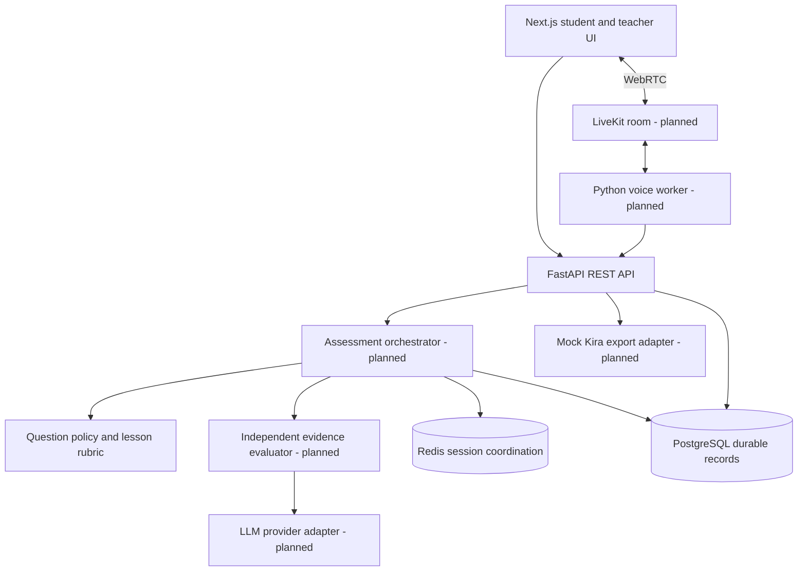

# Architecture

Status: Day 1. Components marked *(planned)* do not exist in code yet.

## Diagram



## Component responsibilities

| Component | Code | Responsibility |
|---|---|---|
| Lesson schema | `backend/app/domain/models.py` | Defines a valid lesson; rejects broken references, missing rubric levels, ambiguous diagnostics |
| Lesson catalog | `backend/app/lesson_catalog.py` | Loads `data/lessons/*.json`, checks filename = id + version, hashes content |
| State machine | `backend/app/domain/state.py` | The only legal session status transitions; everything else raises |
| Question policy | `backend/app/domain/policy.py` | Pure function: (lesson, turn history, time, budget) → next action. Only returns question IDs from the lesson |
| Lesson repository | `backend/app/repositories/lessons.py` | Idempotent publish; changed content under an existing version is a conflict |
| Migrations | `backend/migrations/` | Schema plus a trigger that makes published lesson versions immutable |
| API | `backend/app/main.py`, `backend/app/api/health.py` | App factory, startup fixture validation, `/health`, `/ready` |
| Seed | `backend/app/seed.py` | Publishes all fixtures in one transaction |

## Dependency direction

```text
api  ──►  services (planned)  ──►  domain
 │              │
 └──► repositories ──► db
```

`domain/` imports nothing from FastAPI, SQLAlchemy, Redis or provider SDKs. Assessment rules can
then be tested in microseconds, reused by the text API, voice worker and benchmark scripts, and
reviewed without reading infrastructure code. Pydantic is used in the domain only for validating
authored lesson data.

## Request flow today

1. `uvicorn app.main:app` calls `create_app()`. Lifespan startup runs `load_catalog()`; an invalid
   fixture raises and the process never serves traffic.
2. Engine and Redis clients are created lazily; no connection is made at startup.
3. `GET /health` returns `ok` without touching dependencies (liveness).
4. `GET /ready` runs each readiness check (`SELECT 1`, Redis `PING`, catalog non-empty) and returns
   503 if any fails. Failure details are logged, not returned.

## Key decisions and tradeoffs

- **Lesson versions are immutable.** Sessions will pin `(lesson_id, version)`. Editing content in
  place would silently change what past transcripts and evidence mean. Enforced three times: frozen
  models in memory, a hash check in the repository, and a database trigger. Cost: any typo fix
  needs a new version.
- **Deterministic policy, not a free-form agent.** Question choice is reproducible, bounded and
  testable without an LLM. Cost: less conversational flexibility; follow-ups must be authored.
- **Budget counts learner turns** (default 5), including hint requests and clarifications. This
  keeps the assessment near the 3–5 minute target. Cost: a learner who asks for many hints may not
  reach every objective; the report will show those objectives as unknown, not zero.
- **Readiness is separate from liveness.** A database outage makes the instance unready but does
  not get a healthy process restarted.
