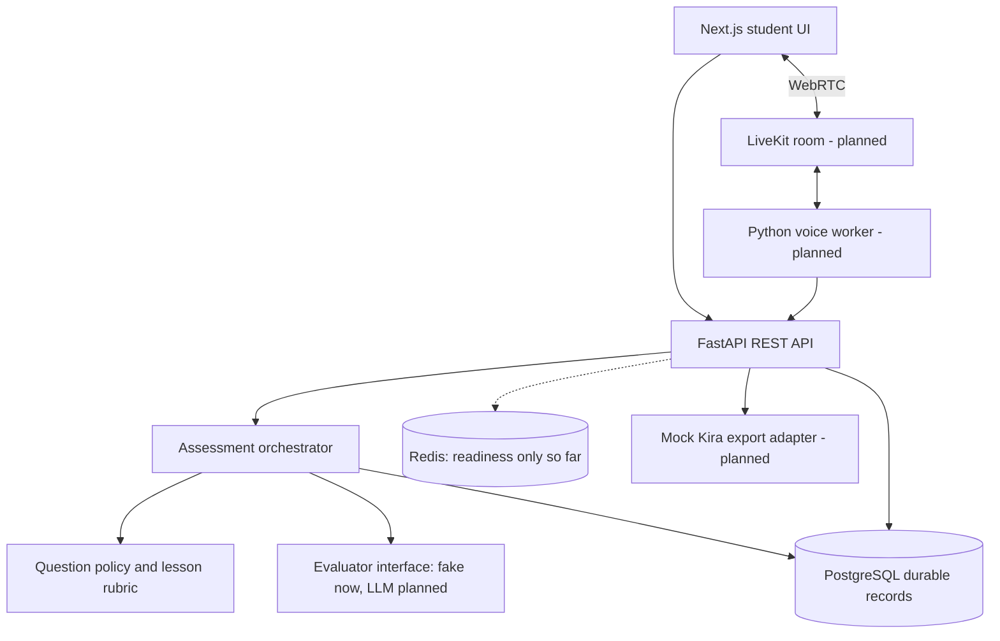

# Architecture

Status: Day 2. Components marked *(planned)* do not exist in code yet.

## Diagram



## Component responsibilities

| Component | Code | Responsibility |
|---|---|---|
| Lesson schema | `backend/app/domain/models.py` | Defines a valid lesson; rejects broken references, missing rubric levels, ambiguous diagnostics |
| Lesson catalog | `backend/app/lesson_catalog.py` | Loads `data/lessons/*.json` at startup and for seeding |
| Lesson store | `backend/app/services/lessons.py` | Reads published versions from Postgres (runtime source of truth), caches forever |
| State machine | `backend/app/domain/state.py` | The only legal session status transitions |
| Question policy | `backend/app/domain/policy.py` | Pure function: (lesson, history, time, budget) → next action |
| Evaluator interface | `backend/app/providers/llm.py` | `Evaluator` protocol: turn → signal (+ misconception tag) |
| Fake evaluator | `backend/app/providers/fake.py` | Deterministic keyword rules; free and reproducible |
| Orchestrator | `backend/app/services/assessment.py` | Sessions, the claim/evaluate/commit turn algorithm, recovery, deadlines |
| Repositories | `backend/app/repositories/` | SQL for lessons, sessions, turns |
| API | `backend/app/api/` | Routes, bearer-token dependency, error → HTTP mapping |
| Student UI | `frontend/components/StudentSession.tsx` | Intro, transcript, answer form, hint/finish, retry and resume |

## Dependency direction

```text
api ──► services ──► domain
          │  └─────► providers (Evaluator protocol)
          └────────► repositories ──► db
```

`domain/` imports nothing from FastAPI, SQLAlchemy, Redis or provider SDKs.

## Request flow: one text turn

1. `StudentSession.send()` builds a `TurnInput` with a `client_turn_id` (kept in storage until
   confirmed) and the latest `state_version`, then calls `api.submitTurn()` (`frontend/lib/api.ts`).
2. `POST /v1/sessions/{id}/turns` → `api/sessions.py:submit_turn` → Pydantic validates the body;
   `api/deps.py:session_token` extracts the bearer token.
3. `AssessmentService.submit_turn`: refresh (T0), claim (T1), evaluator call outside any
   transaction, commit (T2). Details in [api.md](api.md#transaction-design-why-it-is-safe).
4. The policy (`domain/policy.py:next_action`) picks the next question from committed history.
5. The student-facing `TurnResponse` is stored on the turn row and returned. The UI then
   refetches the session to render the transcript.

## Key decisions and tradeoffs

- **Lesson versions are immutable** (frozen models, hash check, DB trigger). Sessions pin
  `(lesson_id, version)` by foreign key.
- **Deterministic policy, not a free-form agent.** Reproducible and bounded; follow-ups must be
  authored.
- **Budget counts learner turns** (default 5), including hint requests and clarifications.
- **Idempotency and concurrency in Postgres**, not Redis. See
  [ADR 0001](adr/0001-database-idempotency.md).
- **Learner "stop" vs "finish early".** Saying a stop phrase ends the session as `completed`
  with `finish_reason = learner_request` (the state machine only allows evaluating →
  completed for a policy finish). Pressing "Finish early" makes it `incomplete` /
  `learner_exit`. Reports (Day 5) must show uncovered objectives as unknown either way.
- **Demo auth is a per-session bearer token**, not real accounts.
