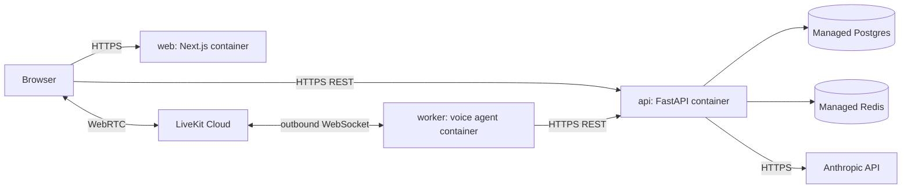

# Deployment

**Status: not deployed.** The container images build and the full stack runs locally with
one command (below). Putting it on a public host needs accounts and secrets only the owner
has; this page is the checklist for doing that.

## Run the whole thing locally in containers

```powershell
docker compose -f compose.full.yaml up --build
# open http://localhost:3000   (API on http://127.0.0.1:8000)
```

Free fake mode by default. Settings in `.env` (see `.env.example`) are passed through, so
`EVALUATOR_PROVIDER=llm` plus `LLM_API_KEY` switches on Claude. Add `--profile voice` to also
run the voice worker (needs the LiveKit settings). Stop the dev servers first: it uses the
same ports 3000 and 8000.

## Topology



| Service | Image / command | Needs | Notes |
|---|---|---|---|
| `web` | `frontend/Dockerfile` | `NEXT_PUBLIC_API_BASE_URL` **at build time** | Stateless |
| `api` | `backend/Dockerfile` (default command) | Postgres, Redis, env below | Runs migrations and the lesson seed on start (both idempotent). With more than one instance, run them as a release step instead |
| `worker` | same image, `python -m app.voice.worker start` | LiveKit settings, `KIRA_API_URL` | **Must be a long-running service** (it holds an outbound connection to LiveKit). It can't run on request-driven serverless. No inbound port needed except its health check (8081) |
| Postgres 16 | managed | | The only durable store. Back it up |
| Redis 7 | managed | | Rate limiting only; losing it loses nothing |
| purge | `python -m app.purge` on a daily schedule | DB | Retention |

## Environment

| Variable | Where | Value |
|---|---|---|
| `APP_ENV` | api, worker | `production` |
| `DATABASE_URL` | api | `postgresql+psycopg://…` from the provider |
| `REDIS_URL` | api | from the provider |
| `FRONTEND_ORIGIN` | api | The exact public web origin(s), comma-separated. This is the CORS allowlist; no wildcard |
| `EVALUATOR_PROVIDER`, `LLM_API_KEY`, `LLM_MODEL`, `LLM_EFFORT` | api | `llm`, key, `claude-haiku-5-5`, `low` (what the benchmark used) |
| `RESPONDER_PROVIDER`, `RESPONDER_SCOPE` | api | `llm` + `side_turns`, or `fake` |
| `LIVEKIT_URL`, `LIVEKIT_API_KEY`, `LIVEKIT_API_SECRET` | api, worker | LiveKit Cloud project |
| `VOICE_WORKER_SECRET` | api, worker | The same random 32+ character value in both |
| `KIRA_API_URL` | worker | The API's URL as the worker reaches it |
| `FORWARDED_ALLOW_IPS` | api | The platform proxy's address if it is fixed; otherwise `*` |
| `NEXT_PUBLIC_API_BASE_URL` | web (build arg) | The API's public HTTPS URL |

Store secrets in the platform's secret manager, never in the image or the repository.

## Before going public

- [ ] HTTPS on web and API (microphones only work on HTTPS or localhost).
- [ ] `FRONTEND_ORIGIN` lists only the real web origin.
- [ ] Health checks: API `GET /health` (liveness) and `GET /ready` (readiness: database,
      Redis, lessons). Worker: its built-in endpoint on 8081.
- [ ] A monthly spend limit on the Anthropic account, and LiveKit usage alerts.
- [ ] Rate limits left on (`RATE_LIMIT_ENABLED=true`).
- [ ] The purge job scheduled.
- [ ] The landing page still says: independent prototype, synthetic data only.

## Smoke test from a clean browser

1. Home loads, three lessons listed.
2. Sign up as a teacher → copy the class code. In a private window sign up as a student
   with the code → start a lesson. It appears on the teacher's board.
3. Answer by typing: "From the soil through its roots." gets the follow-up about leaves.
4. Block the microphone, click the mic: a message says typing still works, and it does.
5. Allow the microphone: the agent greets, answers are transcribed, the closing line plays.
6. Review: evidence quotes link to the transcript; change a level (reason required);
   approve; export downloads JSON.
7. `GET /ready` returns 200.

## Rollback and failure modes

- **Rollback:** redeploy the previous image tag. Migrations so far only add tables and
  columns, so the previous code runs against the newer schema. A migration that isn't
  backward compatible needs a two-step release.
- **Anthropic down or slow:** answers return 503 and the learner is asked to resend; nothing
  is lost or scored. Sessions can time out to `incomplete`.
- **LiveKit or the worker down:** voice is unavailable or drops; the text form on the same
  page keeps working.
- **Redis down:** `/ready` reports not ready; rate limiting fails open; assessments continue.
- **Postgres down:** nothing works; `/health` still answers so the process isn't restarted
  in a loop, `/ready` returns 503.
- **API restarted mid-answer:** the turn's lease expires and the answer can be resent with
  the same id; it can't be saved twice.

## Tradeoffs worth defending

1. **Idempotency and concurrency in Postgres, not Redis.** Slower than a cache, but
   correctness survives losing Redis entirely.
2. **A model judges every answer before the agent speaks.** That costs 1.5–3 s per turn and
   rules out the 1.5 s voice target, in exchange for follow-ups that depend on what was said.
3. **Limitation:** the demo has no real identities, so "teacher" and "learner" are whoever
   holds a token.
