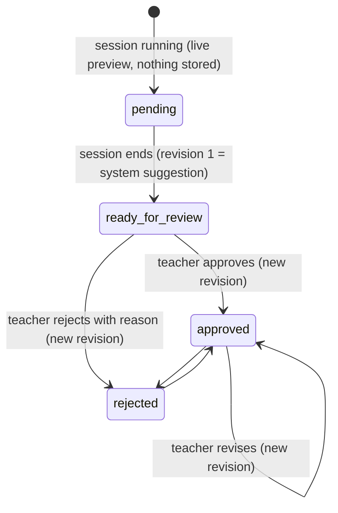

# Teacher review and export

A teacher sees what a learner actually said, the evidence behind each suggested rubric
level, and decides. Nothing reaches the (mock) Kira adapter until a teacher approves it.

## Demo access and isolation

| Who | Credential | Can do |
|---|---|---|
| Demo teacher | `teacher_token` (`kvt_…`), from `POST /v1/teacher/workspaces` | Launch sessions in their classroom; see, review and export only those reports |
| Learner | `session_token`, one per session | Answer that one session; never sees evidence, levels or reports |
| Anyone | none | Create a classroom; start an anonymous home-page session (no teacher can see it) |

- Only SHA-256 hashes of both tokens are stored.
- A report from another classroom, an anonymous session and an unknown id all answer
  `404`, so a caller can't probe which sessions exist.
- A learner token on a teacher route gets `401 teacher_not_found`.
- This is isolation between synthetic demo classrooms, **not** school authentication.
  A real deployment needs real accounts, SSO and role checks.

## Report lifecycle



- **Revision 1** is created once, when a teacher first opens a finished session. A unique
  `(session_id, revision)` constraint makes concurrent first opens safe. Evidence can't
  change after a session ends, so creating it lazily gives the same result as creating it
  at the end. Opening a session also applies its deadline, so an abandoned session
  becomes `incomplete / timeout` instead of looking "in progress" forever.
- **Each decision creates a new revision** with a `reviews` row linking the revision the
  teacher saw (`report_id`) to the one their decision produced (`result_report_id`). The
  suggestion (`suggested_level`) and the decision (`level`) are both kept for every
  criterion.
- **Stale reviews are refused.** Reviewing or exporting anything but the latest revision is
  `409 stale_revision`. The session row lock serializes reviews, and the unique constraint
  backs it up. A test fires 4 concurrent reviews at once: exactly one is saved.

### Review rules (`POST /v1/reports/{report_id}/review`)

| Decision | Requires |
|---|---|
| `approve` | `levels` for **exactly** the lesson's criteria, each 0–3 or `null` ("insufficient evidence"). A `reason` if any level differs from the revision being reviewed |
| `reject` | a `reason` |

Violations are `422 invalid_review`. Unknown stays unknown unless the teacher decides
otherwise, with a reason.

## Why the review is auditable

- `reports`, `reviews` and `export_events` are **append-only**. A database trigger
  (migration 0005) rejects any `UPDATE` or `DELETE`, even from a buggy query or a manual
  SQL session.
- The only exception is deleting a whole session (the retention path), which cascades
  through the trigger by design. Both behaviours are tested.
- Every revision records who made it and when, and every review records the decision, the
  levels and the reason. The teacher page shows this trail in order.
- Evidence rows carry the evaluator and prompt version that produced them. The export
  carries the set of evaluator versions.

## Export (`POST /v1/reports/{report_id}/export`)

Why export is its own boundary: suggestions and reviews stay inside Kira Verbal. Only a
deliberate, approved, versioned decision crosses into another system, and it does so in a
form that is safe to retry.

- **Only the latest approved revision.** Anything else is `409 report_not_approved` or
  `409 stale_revision`.
- **At most once per revision.** `export_events.report_id` is unique, and
  `idempotency_key = kira-verbal:<session>:rev<n>` is deterministic and unique. A repeat
  returns the stored event with `replayed: true`.
- **Outbox order.** The event is committed first, then handed to the adapter. The mock
  receiver applies each key once, so a re-delivery changes nothing (tested).
- **A later revision** needs its own approval and export, with a new key. The earlier
  export is unchanged.

### Payload (`kira-verbal.mastery-update.v1`, built by `providers/kira_mock.py`)

```json
{
  "schema_version": "kira-verbal.mastery-update.v1",
  "idempotency_key": "kira-verbal:ab09c62c-…:rev2",
  "source": {"system": "kira-verbal-prototype", "disclaimer": "Independent prototype export. Not a Kira Learning API…"},
  "learner": {"synthetic_learner_id": "demo-smoke"},
  "activity": {"type": "oral_assessment", "lesson_id": "photosynthesis", "lesson_version": 1, "…": "…"},
  "review": {"decision": "approved", "report_revision": 2, "reviewer_id": "demo-teacher", "reason": "…"},
  "objectives": [
    {"objective_id": "carbon_dioxide", "status": "assessed", "level": 2, "suggested_level": 1,
     "teacher_changed_level": true, "misconceptions": ["co2_from_roots"],
     "evidence": [{"turn_sequence": 2, "quote": "From the soil through its roots.", "assisted": false}]},
    {"objective_id": "light", "status": "insufficient_evidence", "level": null, "evidence": []}
  ],
  "coverage": {"assessed": 2, "total": 3},
  "provenance": {"rubric": {"lesson_id": "photosynthesis", "lesson_version": 1}, "evaluator_versions": ["…"]}
}
```

Only **accepted** evidence is exported. Abstained, rejected and side-turn items never are.

**This is not a Kira Learning API.** A real integration would need Kira's authorized
APIs, a data-processing agreement, and a security and privacy review.

## Wellbeing flags

Turns the evaluator classed as `wellbeing_concern` are listed on the report
(`wellbeing_turns`) and in the session list ("Needs follow-up"). This is a prompt for the
teacher to check in, not a safeguarding system.

## Code map

| Piece | File |
|---|---|
| Tables and append-only triggers | `migrations/versions/0005_reports.py`, `db/models.py` |
| Service: workspaces, lifecycle, review, export | `services/reports.py` |
| Routes | `api/teacher.py` |
| Contracts | `schemas/reports.py` |
| Export payload and mock receiver | `providers/kira_mock.py` |
| Teacher UI | `frontend/components/TeacherDashboard.tsx`, `ReportReview.tsx` |
| Tests | `tests/integration/test_reports.py` (25), `tests/unit/test_kira_mock.py` (5) |
